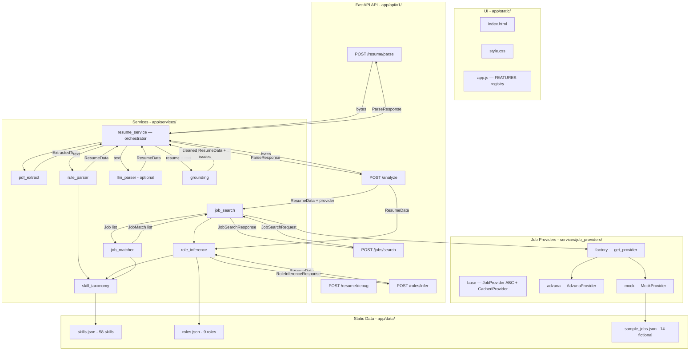

# JobHunt — Phase 1 Analysis

> Generated: 2026-10-06 | Baseline: **50 tests passing** (`pytest -q` exit 0)
> Commit: `e439e0a` ("Added more api ways to search job and minimal Ui")

---

## (a) Architecture & Data-Flow



### Request lifecycle

1. **Upload** -> `pdf_extract` yields `ExtractedText` (text + links + warnings)
2. **Parse** -> `llm_parser` (if key present, else skip) -> `rule_parser` (always available) -> `ResumeData`
3. **Ground** -> `grounding.ground_resume()` strips ungrounded skills/numbers -> `(ResumeData, GroundingIssue[])`
4. **Infer roles** -> `role_inference.infer_roles()` -> `RoleInferenceResponse`
5. **Search jobs** -> `job_search.search_jobs()` -> fan-out to provider -> dedup -> `job_matcher.match_job()` per job -> sort -> `JobSearchResponse`

---

## (b) Module Inventory

| Module | Path | Purpose |
|---|---|---|
| `main.py` | `app/main.py` | FastAPI app, router wiring, static mount, `/health` |
| `config.py` | `app/core/config.py` | Loads `.env`, exposes Adzuna creds/country/provider/TTL |
| `resume.py` (api) | `app/api/v1/resume.py` | `POST /resume/parse`, `POST /resume/debug` |
| `roles.py` (api) | `app/api/v1/roles.py` | `POST /roles/infer` |
| `jobs.py` (api) | `app/api/v1/jobs.py` | `POST /jobs/search` |
| `analyze.py` (api) | `app/api/v1/analyze.py` | `POST /analyze` (all-in-one) |
| `resume.py` (schema) | `app/schemas/resume.py` | `ResumeData`, `ParseResponse`, `Skill`, `Project`, etc. |
| `roles.py` (schema) | `app/schemas/roles.py` | `RoleMatch`, `RoleInferenceResponse` |
| `jobs.py` (schema) | `app/schemas/jobs.py` | `Job`, `JobMatch`, `JobSearchRequest`, `JobSearchResponse` |
| `pdf_extract.py` | `app/services/pdf_extract.py` | PDF/DOCX -> plain text; scanned PDFs rejected |
| `rule_parser.py` | `app/services/rule_parser.py` | Deterministic text -> `ResumeData` via headings + regex |
| `llm_parser.py` | `app/services/llm_parser.py` | Optional Anthropic-based parsing (never tested live) |
| `grounding.py` | `app/services/grounding.py` | Strips invented facts from parsed resume |
| `resume_service.py` | `app/services/resume_service.py` | Orchestrator: extract -> parse -> ground -> enrich links |
| `skill_taxonomy.py` | `app/services/skill_taxonomy.py` | Word-boundary regex matching over skills.json |
| `role_inference.py` | `app/services/role_inference.py` | Score resume against 9 role profiles |
| `job_search.py` | `app/services/job_search.py` | Fan-out to provider, dedup, match, rank |
| `job_matcher.py` | `app/services/job_matcher.py` | Score one job vs one resume |
| `base.py` | `app/services/job_providers/base.py` | `JobProvider` ABC, `CachedProvider` TTL wrapper |
| `adzuna.py` | `app/services/job_providers/adzuna.py` | Adzuna REST API client |
| `mock.py` | `app/services/job_providers/mock.py` | Offline demo provider from `sample_jobs.json` |
| `factory.py` | `app/services/job_providers/factory.py` | Singleton provider selection |
| `skills.json` | `app/data/skills.json` | 58 skills with aliases |
| `roles.json` | `app/data/roles.json` | 9 role profiles |
| `sample_jobs.json` | `app/data/sample_jobs.json` | 14 fictional job postings (includes deliberate duplicate) |
| `index.html` | `app/static/index.html` | Minimal HTML shell |
| `style.css` | `app/static/style.css` | Dark/light theme, utility classes |
| `app.js` | `app/static/app.js` | Feature registry SPA (vanilla JS, 175 LOC) |

---

## (c) Public Contracts

### Endpoints

| Method | Path | Request | Response |
|---|---|---|---|
| `POST` | `/api/v1/resume/parse` | `UploadFile` (PDF/DOCX, max 5 MB) | `ParseResponse` |
| `POST` | `/api/v1/resume/debug` | `UploadFile` | `{links, warnings, sections_found, text}` (ad-hoc dict) |
| `POST` | `/api/v1/roles/infer` | `ResumeData` (JSON body) | `RoleInferenceResponse` |
| `POST` | `/api/v1/jobs/search` | `JobSearchRequest` (JSON body) | `JobSearchResponse` |
| `POST` | `/api/v1/analyze` | `UploadFile` + query `include_jobs`, `location` | `AnalyzeResponse` |
| `GET`  | `/health` | -- | `{"status": "ok"}` |
| `GET`  | `/` | -- | `index.html` (FileResponse) |

### Pydantic Schemas

**`app/schemas/resume.py`:**
- `Personal` -- name, email, phone, links
- `Bullet` -- id, text
- `Education` -- id, degree, institute, years, score
- `Skill` -- name, category, source (Literal: skills_section, coursework, project_text, inferred), inferred_from
- `Project` -- id, title, bullets[], skills_used[]
- `Experience` -- id, title, bullets[], skills_used[]
- `ResumeData` -- personal, education[], skills[], projects[], experience[], coursework[], certifications[], achievements[]
  - Has `_accept_parse_response` model_validator that unwraps `{"resume": {...}}` to tolerate pasting the whole ParseResponse.
- `GroundingIssue` -- field, value, action (Literal: removed, flagged), reason
- `ParseResponse` -- resume, grounding_issues[], warnings[], parser (Literal: rule_based, llm)

**`app/schemas/roles.py`:**
- `RoleMatch` -- role, score, matched_core[], missing_core[], matched_optional[], evidence{}, query_titles[], explanation
- `RoleInferenceResponse` -- level, roles[]

**`app/schemas/jobs.py`:**
- `Job` -- source, external_id, title, company, location, description, url, posted_at, salary_min, salary_max, salary_predicted, contract_type
- `JobMatch` -- job, score, matched_skills[], missing_required[], missing_preferred[], jd_skills_found, title_relevance, level_fit, experience_required_years, via_roles[], flags[]
- `JobSearchRequest` -- resume, roles, location, top_roles(3), max_results(30), min_score(25.0)
- `RoleQuery` -- role, role_score, queries[], fetched
- `JobSearchResponse` -- provider, level, roles_used[], total_fetched, after_dedup, jobs[], warnings[]
- `AnalyzeResponse` (defined inline in `analyze.py`) -- parse, roles, jobs

---

## (d) README Claims: TRUE / FALSE / UNVERIFIABLE

| # | Claim (README line) | Verdict | Evidence |
|---|---|---|---|
| 1 | "25 tests" (L7) | **FALSE** -- **50 tests** pass as of this run | `pytest -q` output: `50 passed` |
| 2 | Pipeline: `file -> pdf_extract -> (llm_parser or rule_parser) -> grounding -> ResumeData -> role_inference` (L22) | **TRUE** | `resume_service.py:9-28` implements exactly this chain |
| 3 | `skill_taxonomy.py` + `data/skills.json`: alias map, word-boundary matching (Java != JavaScript, C != C++) (L24) | **TRUE** | `skill_taxonomy.py:12-13` uses lookbehind/ahead on `[A-Za-z0-9+#]`; tested in `test_pipeline.py:34-39` |
| 4 | `grounding.py`: removes ungrounded skills, flags invented numbers (L25-26) | **TRUE** | `grounding.py:21-74`; tested in `test_pipeline.py:77-92` |
| 5 | "Reused later to validate tailored resumes" (L26) | **FALSE** -- no tailoring module exists; the comment is aspirational | No `tailor` file anywhere in codebase |
| 6 | `role_inference.py` + `roles.json`: explainable scoring (L27) | **TRUE** | `role_inference.py:44-87` |
| 7 | MERN/MEAN expand to parts as `source="inferred"` with `inferred_from` (L28) | **TRUE** | `rule_parser.py:220-224`; tested in `test_pipeline.py:95-101` |
| 8 | Scanned PDFs rejected; OCR not implemented (L31) | **TRUE** | `pdf_extract.py:46-48` raises `ScannedPDFError` |
| 9 | `llm_parser.py` NOT run against the live API (L34) | **UNVERIFIABLE** -- no API key available to test; code exists and looks reasonable | `llm_parser.py:27-38` |
| 10 | Taxonomy covers ~60 skills (L36) | **TRUE** -- 58 skills counted | `skills.json` has 58 entries |
| 11 | `roles.json` has 9 roles (L36) | **TRUE** | 9 roles confirmed |
| 12 | `POST /api/v1/resume/debug` shows raw text + detected sections (L37) | **TRUE** | `resume.py:22-35` |
| 13 | Providers: `AdzunaProvider` (live), `MockProvider` (fictional), `CachedProvider` (L42-43) | **TRUE** | All three exist in `services/job_providers/` |
| 14 | Quota: one search = top_roles x 2 provider calls (default 6) (L46) | **TRUE** -- `QUERIES_PER_ROLE = 2`, default `top_roles = 3` = 6 calls | `job_search.py:11` |
| 15 | Scoring: 45/30/15/10, caps at 40 and 55 (L47-48) | **TRUE** | `job_matcher.py:21` and `job_matcher.py:109-112` |
| 16 | "Adzuna LIVE calls are NOT tested against the real API here" (L53) | **UNVERIFIABLE** -- no keys in repo, tests use `MockTransport` | `test_jobs.py:33-34` |
| 17 | "Not built yet: S3 upload, database, auth, ATS check, JD analyzer, tailoring, tracker, UI" (L59) | **PARTIALLY FALSE** -- UI **is** built (basic); the rest are truly absent | `app/static/` has a working SPA |

### Claims in PROJECT CONTEXT vs. code

| Claimed | Actual | Verdict |
|---|---|---|
| `app/data/india.py` (city aliases) | Does not exist | **FALSE** |
| `app/db` (SQLAlchemy, SQLite) | Does not exist; no `sqlalchemy` in `requirements.txt` | **FALSE** |
| `app/cli.py` (ingest, stats, doctor) | Does not exist | **FALSE** |
| Services: `job_store`, `ingest`, `doctor` | None exist | **FALSE** |
| "about 60 tests" | **50 tests** (2 test files + `sample_resume.py`) | **FALSE** |
| Role score: 45% core + 35% evidence + 10% optional + 10% education | **TRUE** | `role_inference.py:18` |
| Job score: 45/30/15/10 with caps | **TRUE** | `job_matcher.py:21,109-112` |

---

## (e) Bugs, Fragile Spots, and Risks

### Critical

| # | Issue | File:Line | Impact |
|---|---|---|---|
| B1 | **Blocking sync work in async endpoints.** `parse_upload()` calls `pdfplumber.open()` (CPU + I/O-bound) synchronously inside `async def parse_resume_file()`. With multiple concurrent uploads, this blocks the single-threaded event loop. Same for `rule_parser.parse_resume()` and `llm_parser.parse_with_llm()` (which also does a sync HTTP call to Anthropic). | `resume.py:12-18`, `analyze.py:28-32` | Event-loop stall under load |
| B2 | **No magic-byte validation on uploads.** File type is determined solely by extension (`filename.lower().endswith(".pdf")`). A user can upload malicious content with a `.pdf` extension and it reaches `pdfplumber.open()`. | `pdf_extract.py:76-81` | Potential DoS / crash via malformed input |
| B3 | **Resume text may leak into logs.** No safeguard prevents resume text (PII) from appearing in exception tracebacks, FastAPI logs, or the `/debug` endpoint response. The `llm_parser` passes the full resume text to Anthropic without redaction. | `resume_service.py:18-19` | PII exposure |

### Medium

| # | Issue | File:Line | Impact |
|---|---|---|---|
| B4 | **`get_provider()` is cached with `lru_cache`** -- process-wide singleton. If env vars change at runtime (e.g., tests with `monkeypatch`), the stale provider persists. Tests work around this with explicit `cache_clear()`, but it is brittle. | `factory.py:9-10` | Test isolation issue; not a prod bug |
| B5 | **`lru_cache` on `get_taxonomy()` and `_roles()`** -- singleton-loaded at import from JSON files. If files are updated at runtime (e.g., after taxonomy import in G4), the cache is stale. | `skill_taxonomy.py:80-82`, `role_inference.py:21-23` | Stale data after updates |
| B6 | **No request-size middleware.** The 5 MB check in `/resume/parse` is after `await file.read()` -- the full body is already in memory. No server-level limit exists. A 100 MB upload still hits the endpoint. | `resume.py:13-15` | Memory exhaustion risk |
| B7 | **Adzuna provider creates a new `httpx.AsyncClient` per search call** (`async with httpx.AsyncClient(...)` in the `search` method). This wastes TCP connections and prevents connection pooling. | `adzuna.py:48` | Performance, connection churn |
| B8 | **No retry/backoff in Adzuna provider.** A 429 or transient 5xx raises `ProviderError` immediately. No retries. | `adzuna.py:54-57` | Fragile under rate limiting |
| B9 | **`title_relevance()` uses `SequenceMatcher` on sorted tokens** -- this is O(n^2) string comparison, though the strings are short so it is not a performance problem today. | `job_matcher.py:46` | Correctness: sorted tokens may not be the best metric |
| B10 | **`AnalyzeResponse` is defined inline in `analyze.py`**, not in `app/schemas/`. Inconsistent with the rest of the schema organization. | `analyze.py:17-20` | Maintainability |

### Low / Style

| # | Issue | File:Line |
|---|---|---|
| B11 | `_HEADING` dict in `rule_parser.py` does not handle plurals/typos beyond `FUZZY`. E.g., "Work Experiences" would fail. | `rule_parser.py:22` |
| B12 | `PHONE` regex may over-match (e.g., long numbers in CGPA or dates). | `rule_parser.py:26` |
| B13 | The `debug` endpoint imports at call time (`from app.services.pdf_extract import extract_text`). Not a bug but inconsistent. | `resume.py:26-27` |
| B14 | `sample_jobs.json` has `posted_at` dates all set to `2026-09-28` -- no recency variation for testing date-based filters. | `sample_jobs.json` |

---

## (f) Test Coverage

### What IS covered (50 tests across 2 files)

**`test_pipeline.py`** (30 tests):
- Taxonomy: word boundaries, canonical aliases, false-positive regression
- Section splitting, rule parser structure, unique IDs
- Grounding: removes invented skills, keeps clean parse clean, MERN inference
- PDF extraction: roundtrip, scanned rejection, unsupported type, DOCX, hyperlinks
- Education: table rows, header skipping, school rows with per-row scores, coursework vs certifications
- Role inference: MERN fresher top 3, empty resume
- API: `/resume/parse`, `/resume/debug`, `/analyze`, `/roles/infer` (with wrapped/bare body)
- Nested bullet layout regression

**`test_jobs.py`** (20 tests):
- Adzuna: request shape, HTML stripping, per-page cap, error codes (401/429/500), network error, key non-leaking
- CachedProvider: TTL prevents second call
- Matcher: required/preferred classification, years parsing, level fit rules, title relevance, gap reporting, low confidence flag
- Dedup key normalization
- Full search flow: ranking, dedup, location filter, empty resume, provider failure, partial failure
- API: `/jobs/search`, 503 on missing keys, `/analyze?include_jobs=true`
- Fresher level gates (score caps)

### What is NOT covered

| Area | Gap |
|---|---|
| DOCX with tables | Only basic DOCX extraction tested; table-heavy layout untested |
| LLM parser | Not tested at all (no mock of Anthropic API) |
| `llm_parser.parse_with_llm()` | No unit test; depends on live API |
| Two-column / creative resume layouts | No test fixtures |
| Concurrent uploads | No load/stress tests |
| UI (`app.js`, `style.css`) | No browser tests |
| Error path in `extract_docx` for corrupted files | Only PDF corruption tested implicitly |
| `CachedProvider` TTL expiration | Only non-expiry tested |
| `health` endpoint | Not tested (trivial) |
| Edge case: resume with zero text after extraction | Only `MIN_CHARS` threshold tested indirectly |
| Integration: Adzuna to matcher to ranking (live) | Mocked only |

---

## (g) Gap Readiness Assessment

| Gap | Status | Notes |
|---|---|---|
| **G1** Weighted keyword profile | **Missing** | No `KeywordProfile` schema, no `/api/v1/resume/keywords` endpoint. Skill weights are implicit (binary: present/absent). Skill `source` field exists (skills_section, coursework, project_text, inferred) which is a foundation. |
| **G2** Evaluation harness | **Missing** | No `eval/` directory, no CLI, no labelled fixtures, no metrics infrastructure. |
| **G3** Title normalization | **Missing** | `_tokens()` in `job_matcher.py` strips level words as a set but returns tokens, not a canonical form. `_LEVEL_WORDS` at L29-30 is a start. No fuzzy matching, no alias table, no `SDE` to `Software Development Engineer` mapping. |
| **G4** Large vocabulary import | **Missing** | No database, no CLI, no ESCO/NCO support. `skills.json` is the only taxonomy source. |
| **G5** Data-driven title profiles | **Missing** | No database for jobs, no TF-IDF, no stored profiles. |
| **G6** Multi-method title voting | **Missing** | Only one method exists (roles.json rules). No `TitlePredictor` interface. |
| **G7** Multi-stage funnel | **Missing** | `job_search.py` does a simple fetch, dedup, match, sort, filter by `min_score`. No staged filtering, no per-stage counts, no rejection reasons. |
| **G8** Intern/fresher mode | **Partially present** | `infer_level()` returns `"fresher"` or `"experienced"` based on internship titles (`role_inference.py:30-33`). Fresher titles are used in queries. `JUNIOR` regex includes "intern" for level fit. **Missing**: explicit `job_type` filter (intern, fresher, or any) in API/UI, ingestion queries for internships, intern detection beyond title words. |
| **G9** Provider robustness | **Partially present** | `CachedProvider` exists. Adzuna raises `ProviderError` with sanitized messages. **Missing**: retry/backoff, 429 handling, bulk upsert, marking jobs inactive, `doctor` CLI, JSearch provider stub. |
| **G10** Quality hygiene | **Partially present** | 5 MB upload limit exists. Error messages do not leak keys. **Missing**: `run_in_executor` for CPU-bound parsing, magic-byte validation, PII logging safeguards, server-level request-size middleware. |
| **G11** UI enhancements | **Missing** | Current UI has Resume/Roles/Jobs/Debug/ATS/Tailor/Tracker. No keyword weights, title voting, funnel counts, or intern toggle. The `FEATURES` registry pattern is established and extensible. |
| **G12** Docs | **Missing** | No `docs/ARCHITECTURE.md`, no `CHANGELOG`. README is outdated (says 25 tests, lists unbuilt features as built). |

### Correcting your assumptions

1. **`app/data/india.py`** -- Does not exist. There is no city alias mapping anywhere.
2. **`app/db`** -- Does not exist. No SQLAlchemy, no SQLite, no `DATABASE_URL`. The app is fully stateless (in-memory only).
3. **`app/cli.py`** -- Does not exist. No CLI for `ingest`, `stats`, or `doctor`.
4. **Services `job_store`, `ingest`, `doctor`** -- None exist.
5. **"about 60 tests"** -- There are **50 tests**, not 60. Two test files, not a `sample_resume.py`.
6. **`sample_jobs.json` is described as "fictional"** -- **TRUE**, it is clearly labelled as `"_note": "FICTIONAL demo data"`.
7. **The suggested gap order mentions G4 before G5** -- This is correct because G5 (data-driven profiles) needs a job database that G4 establishes. However, G4 itself needs a database layer (absent today), so **a database layer is an unlisted prerequisite** for G4, G5, G8 (ingestion), and G9 (marking inactive). I will call this **G0: Database layer**.

---

## Prioritized Implementation Plan

```
G0*  Database foundation (SQLite + SQLAlchemy)    <-- unlisted prerequisite for G4, G5, G8, G9
G2   Evaluation harness                           <-- measures everything else
G1   Weighted keyword profile                     <-- standalone, enables G5/G6
G3   Title normalization                           <-- standalone, enables G5/G6
G10  Quality hygiene                               <-- low risk, high impact, can be done in parallel
G4   Large vocabulary import                       <-- needs G0
G5   Data-driven title profiles                    <-- needs G0, G3
G6   Multi-method title voting                     <-- needs G1, G3, G5
G7   Multi-stage funnel                            <-- needs G3, G6
G8   Intern/fresher mode                           <-- needs G0 for ingestion queries
G9   Provider robustness                           <-- needs G0 for marking inactive
G11  UI enhancements                               <-- needs G1, G6, G7, G8
G12  Docs                                          <-- last, captures everything
```

> *G0 is not in the original spec but is required: there is no database, no `india.py`, no CLI today. G4/G5/G8/G9 all need persistent storage.

---

## Blocking Questions

1. **G0 / Database scope:** The project claims to have a database layer (`app/db`, SQLAlchemy, SQLite) but none exists. Should I build it as part of G4 (when it is first needed) or as a separate foundational step (G0)? This affects G4, G5, G8, and G9.

2. **`india.py` city aliases:** The spec mentions `india.py` for the funnel's city filter (G7), but the file does not exist. Should I create a city alias mapping (e.g., `Bengaluru` = `Bangalore`, `Gurugram` = `Gurgaon`), or should the city filter just use substring matching on the existing location strings?

3. **G4 taxonomy import -- ESCO/NCO CSV format:** You say "loading user-supplied CSVs" -- do you have specific ESCO or NCO CSVs in mind (column names, delimiter), or should I design a flexible importer that validates common column patterns and fails clearly on unexpected schemas?

4. **G2 evaluation harness -- real data:** The harness ships with 3 synthetic fixtures. Do you want me to also build scaffolding for adding your own labelled resumes + job relevance judgments later (a `eval/data/` directory with a documented JSON schema), or is the synthetic-only version sufficient for now?

5. **G6 embeddings and LLM -- optional import:** The spec says embeddings (`sentence-transformers`) and LLM proposal are "optional behind feature flags." Should these be importable stubs that raise `NotImplementedError` if the library is not installed, or full implementations gated by an env var (e.g., `ENABLE_EMBEDDINGS=true`)?

---

**Phase 1 complete. No code was changed. Awaiting your approval and answers to proceed to Phase 2.**
